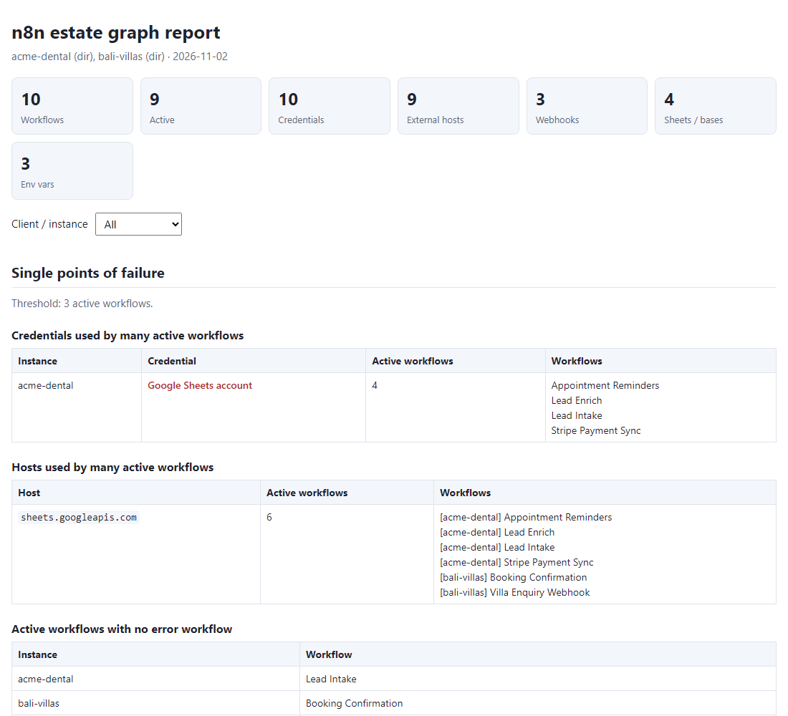

# n8n-estate-graph

A client's Google credential expires. Which workflows just died? (On the sample below: 7.)

n8n-estate-graph reads your exported workflows (or a live n8n instance, read-only) and maps everything they depend on into one graph: credentials, webhooks, Google Sheets and Airtable bases, external hosts, env vars, schedules and sub-workflow calls. Then you ask it what breaks if any one of those dies.

## What it does

- Builds `graph.json`, a self-contained `report.html` and a `report.md` from one instance or many clients at once.
- `blast`: pick a credential, host, sheet, workflow or env var and get every affected workflow. It follows `Execute Workflow` calls upward, so a workflow that calls a broken sub-workflow is listed too, with the path that explains why. It also tells you when an affected workflow is someone's error workflow, because then their failures go quiet.
- `spof`: credentials and hosts that many active workflows lean on, active workflows with no error workflow, webhooks with authentication set to none, sub-workflows called by many.
- Keeps clients apart. Two clients' "Gmail account" are two credentials, identified by instance plus credential id, never merged by name.
- Reads an allow-list of fields only. Credential secrets are never read or written, URLs are reduced to a hostname, sticky notes are ignored, and token-shaped strings are masked. That is not the same as anonymous: names and ids are kept so the map is useful. See "Before you share the output" and `--redact-all`.
- Zero runtime dependencies. Node 20 or newer.

## Quickstart

```bash
git clone https://github.com/waseemnasir2k26/n8n-estate-graph && cd n8n-estate-graph

# 1. From exported workflow JSON. Without --label, each first-level subfolder is one client,
#    so `--from-dir examples/workflows` alone gives the same two clients.
node bin/n8n-estate-graph.js build \
  --from-dir examples/workflows/acme-dental --label acme-dental \
  --from-dir examples/workflows/bali-villas --label bali-villas \
  --out estate-graph-out

# 2. What breaks if this credential dies?
node bin/n8n-estate-graph.js blast --graph estate-graph-out/graph.json --credential "Google Sheets account"

# 3. Where are the single points of failure?
node bin/n8n-estate-graph.js spof --graph estate-graph-out/graph.json

# Or straight from a live instance. GET requests only; the key comes from the environment.
N8N_API_KEY=... node bin/n8n-estate-graph.js build --instance prod=https://n8n.example.com
# Several instances: N8N_API_KEY_PROD, N8N_API_KEY_CLIENTB, ... (label upper-cased)
```

Open `estate-graph-out/report.html` in a browser. There are no external scripts and no network calls. The tables are plain static HTML (a test checks that no row is hidden in the markup); a small inline script only adds the client filter.



`blast` accepts `--credential`, `--host`, `--sheet`, `--workflow` or `--env`, plus `--json`. It reads a saved `--graph` or builds from the same inputs on the fly. Exit codes: 0 ok, 1 runtime error, 2 usage error, 3 input had zero workflows, 4 `blast` matched nothing.

Flags for output safety: `--redact-all` (build, blast, spof) and `--show-paths` (see below).

## Example output

Real output from `examples/workflows` (two fake clients, 10 workflows):

```
Blast radius: credential "Google Sheets account"
  Matches 2 credentials (same name, separate credentials, never merged):
    - [acme-dental] Google Sheets account (googleSheetsOAuth2Api)
    - [bali-villas] Google Sheets account (googleSheetsOAuth2Api)

  If these stop working: 7 workflows affected (6 active, 1 inactive; 7 direct, 0 via sub-workflow calls)
    direct  [acme-dental] Appointment Reminders  (active)
            why: Appointment Reminders -> uses Google Sheets account [acme-dental]
    direct  [acme-dental] Lead Enrich  (active)
            why: Lead Enrich -> uses Google Sheets account [acme-dental]
    direct  [acme-dental] Lead Intake  (active)
            why: Lead Intake -> uses Google Sheets account [acme-dental]
    direct  [acme-dental] Old Review Request (disabled)  (inactive)
            why: Old Review Request (disabled) -> uses Google Sheets account [acme-dental]
    direct  [acme-dental] Stripe Payment Sync  (active)
            why: Stripe Payment Sync -> uses Google Sheets account [acme-dental]
    direct  [bali-villas] Booking Confirmation  (active)
            why: Booking Confirmation -> uses Google Sheets account [bali-villas]
    direct  [bali-villas] Villa Enquiry Webhook  (active)
            why: Villa Enquiry Webhook -> uses Google Sheets account [bali-villas]
```

Sub-workflow chains and error workflows show up when the dead thing sits deeper. `blast --credential "Slack account"` on the same demo (direct `why:` lines trimmed here):

```
Blast radius: credential "Slack account"
  Matches 1 credential:
    - [acme-dental] Slack account (slackApi)

  If it stops working: 4 workflows affected (4 active, 0 inactive; 2 direct, 2 via sub-workflow calls)
    direct  [acme-dental] Error Alerts  (active)
    direct  [acme-dental] Notify Front Desk  (active)
    chain   [acme-dental] Lead Enrich  (active)
            why: Lead Enrich -> Notify Front Desk -> uses Slack account [acme-dental]
    chain   [acme-dental] Lead Intake  (active)
            why: Lead Intake -> Lead Enrich -> Notify Front Desk -> uses Slack account [acme-dental]
  note: [acme-dental] Error Alerts is the error workflow for [acme-dental] Appointment Reminders, [acme-dental] Stripe Payment Sync. Their failures would go unreported.
```

The committed sample (`examples/sample-out`) is reproduced exactly by `npm run demo`, and the test suite checks that. The demo workflows include fake secrets in an HTTP URL query, a header and a sticky note. None of them appears in the output.

## Before you share the output

`graph.json`, `report.html` and `report.md` hold no credential secrets, API keys or URL query strings. They do still hold client identifiers. By default the output retains:

- Credential names and n8n credential ids (a name like `jane@clientco.com Google` keeps the email).
- Workflow names and n8n workflow ids.
- Google Sheet / Doc / Drive `documentId`s and Airtable base/table ids, plus sheet and tab names and cached document names (for example a tab called "Jane Doe invoices").
- Webhook paths. `graph.json` keeps them as written, apart from random-looking segments shown as `{random}`. For webhooks with authentication none the path is effectively the secret, so `spof` and the reports show only the first 4 characters plus a hash unless you pass `--show-paths`. The report's Webhooks table is masked the same way.
- Hostnames of every service and HTTP Request URL, env var names, schedule expressions, and your instance / client labels.

Pattern and entropy scrubbing is best effort: it masks things that look like tokens, not things that are private. Names and emails are not tokens.

Run with `--redact-all` before sending the output to someone outside the engagement. It replaces credential names and ids, workflow names and ids, documentIds, sheet and tab names, webhook paths and hostnames with short stable hashes (`cred#a1b2c3d4`, `wf#...`, `sheet#...`, `tab#...`, `hook#...`, `host#...`), and replaces any email address found anywhere with `email#...`. The same input always gives the same hash, so shared credentials stay shared and `blast` still works (give it the real name; the output shows the hash). Kept as is: instance labels, credential type names such as `googleSheetsOAuth2Api`, env var names, schedules, counts and structure. Read the output once before you send it anyway.

## graph.json

Node-link format: `{ meta, nodes: [{ id, type, label, attrs }], links: [{ source, target, rel }] }`.

- Node types: `workflow`, `credential`, `webhook`, `host`, `sheet`, `envvar`, `schedule`.
- Relations: `uses_credential`, `exposes_webhook`, `calls_host`, `reads_writes`, `calls_workflow`, `error_handler`, `reads_env`, `triggered_by`.
- Output is sorted and has no timestamps. Pass `--date YYYY-MM-DD` if you want one stamped in.

## For you if

- You run n8n for several clients and need to know the damage before a token expires, not after.
- You inherited an instance and want to see what hangs off which credential before you rotate anything.
- You write handover docs or audits and want the dependency map as evidence.

## Honest limits

- Static analysis of exported JSON. Nothing is executed and there is no runtime tracing.
- Expressions in URLs, sheet ids, webhook paths and sub-workflow ids that cannot be resolved show up as `dynamic-expression` and are counted in `meta.dynamicRefs`. Dynamic sheets and dynamic sub-workflow calls are not linked.
- Credentials are listed only if a workflow references them. The public API does not list unused credentials, so orphan credentials are not reported.
- Disabled nodes are skipped. Inactive workflows are shown, but they do not count toward the single-point-of-failure thresholds.
- Service nodes are mapped to their usual API host from a small built-in table of about 40. An HTTP Request node uses its own URL host.
- Credentials created by an external secrets provider appear under the name n8n exports.

## Related

- [@digital-boss/n8n-wf-deps](https://www.npmjs.com/package/@digital-boss/n8n-wf-deps) is a library that extracts dependencies from n8n workflows.
- The n8n template ["Audit workflow credential usage to Google Sheets using Google Drive and SQLite3"](https://n8n.io/workflows/14423) audits credential usage inside one instance.
- [graphify](https://github.com/Graphify-Labs/graphify) maps codebases into a queryable graph and was the inspiration. No code is shared with it.

What this adds is the cross-workflow, cross-instance view with transitive blast radius and a single-point-of-failure report.

## Development

```bash
npm test      # node:test, no dependencies, no network
npm run demo  # rebuilds examples/sample-out
```

## Built by SkynetLabs

Need this wired into your business? SkynetLabs builds voice agents, n8n back offices and sites that convert. https://skynetjoe.com

Contact: [WhatsApp](https://wa.me/6281316077185) or waseem@skynetjoe.com. MIT licensed.
