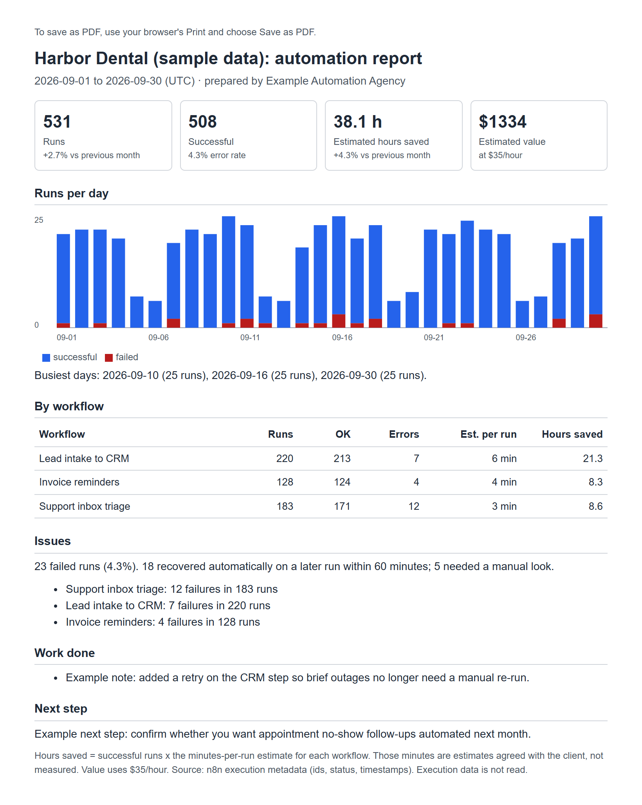
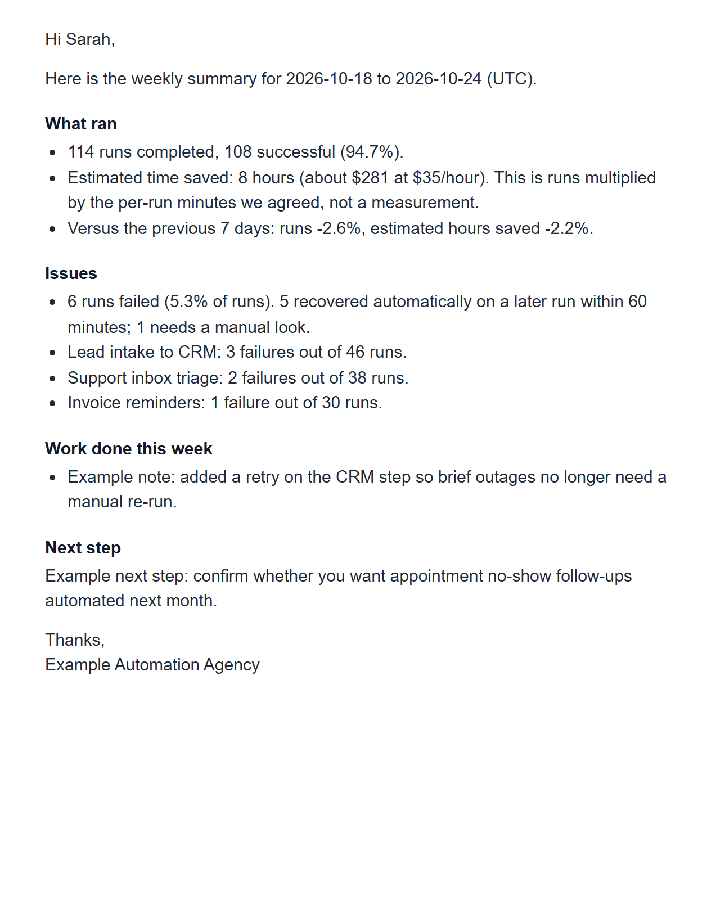

# n8n-retainer-report: weekly client email and monthly one-pager from your n8n execution history


**Your client asks "what am I paying for?" and the only proof you have is an execution list built for developers.**





Try it with no clone and no n8n: `npx github:waseemnasir2k26/n8n-retainer-report --demo` (writes `./retainer-report-demo/`). The npx line works once the repo is public; until then, clone and run `npm run demo`. `--demo` always uses the bundled sample and ignores `--end`, `--month`, `--config` and `--from-file` (only `--out` and `--narrative` apply).

n8n's execution view shows run ids and node timings. A client wants to know what ran, what broke, and what it saved them. This tool reads execution metadata from your n8n instance and writes a short weekly email and a printable monthly one-pager you can send under your own name.

## What it does

- Pulls executions and workflows from the n8n public API (cursor pagination), or reads a JSON file offline.
- Maps workflows to a client by id or tag in `report.config.json`.
- Computes runs, successes, errors, error rate, errors that recovered on a later run, top failing workflows, busiest days, estimated hours saved, estimated value, and change versus the previous period.
- Writes `weekly-email.md` and `weekly-email.html` (plain: what ran, issues, one next step), `monthly-report.html` (single self-contained page with an inline SVG chart, print to PDF), and `report.json`.
- Optional: a 3-sentence summary from a free Groq or Gemini key. The numbers always come from code. The model only sees totals, never workflow names or execution rows, and the summary is labelled as AI-drafted.

Sample output (synthetic data): [monthly-report.html](examples/sample/monthly-report.html) (download and open in a browser), [weekly-email.md](examples/sample/weekly-email.md), [report.json](examples/sample/report.json).

## 60-second quickstart

```bash
git clone https://github.com/waseemnasir2k26/n8n-retainer-report.git
cd n8n-retainer-report

# 1. See it work on synthetic data, no n8n needed
npm run demo
# -> examples/sample/ (open monthly-report.html)

# 2. Run it on your instance
export N8N_BASE_URL=https://n8n.example.com
export N8N_API_KEY=...            # n8n Settings -> n8n API
cp examples/sample.config.json report.config.json   # edit client, workflows, minutes
node bin/n8n-retainer-report.js --out out
```

Requires Node 20+. No `npm install` needed: there are no dependencies. Set `--end 2026-10-24` to pick the last day of the weekly window (default: yesterday, UTC). The monthly report defaults to the full calendar month before that; use `--month 2026-09` to choose.

Offline: `node bin/n8n-retainer-report.js --from-file executions.json`. The file is either an array of executions or `{"executions": [...], "workflows": [...]}`. Include `workflows` if the config uses tags.

## Config

```json
{
  "client": "Harbor Dental",
  "contactName": "Sarah",
  "agency": "Your Agency Name",
  "currency": "$",
  "hourlyRate": 35,
  "recoveryWindowMinutes": 60,
  "workflows": [
    {
      "id": "101",
      "label": "Lead intake to CRM",
      "minutesSavedPerSuccessfulRun": 6
    },
    { "tag": "harbor-support", "minutesSavedPerSuccessfulRun": 3 }
  ],
  "notes": [
    "Added a retry on the CRM step so short outages no longer need a manual re-run."
  ],
  "nextStep": "Confirm whether you want no-show follow-ups automated next month."
}
```

| Field                          | Meaning                                                                                                                           |
| ------------------------------ | --------------------------------------------------------------------------------------------------------------------------------- |
| `workflows[].id` / `tag` | Exactly one per entry. `id` is a string or integer. A tag matches every workflow carrying that tag name, in any client. **Do not reuse one tag across several clients' workflows: they would all land in one report.** Use a tag per client, or list ids. |
| `minutesSavedPerSuccessfulRun` | **Your estimate.** Optional. If missing, that workflow counts as zero hours and the report says so. The tool never fills this in. |
| `hourlyRate`                   | Optional. Without it no money value is shown.                                                                                     |
| `recoveryWindowMinutes`        | Recovery window in minutes (default 60). See "Honest limits" for exactly how recovery is counted. |
| `contactName`                  | Optional first name for the email greeting ("Hi Sarah,"). Without it the greeting is "Hi there,". Never a business name. |
| `notes`                        | Lines you write yourself. The tool cannot know what you fixed, so it does not claim any fixes.                                    |

Invalid configs fail with one message listing every problem.

## Run it inside n8n

No terminal needed: import `examples/n8n-workflow.json` (Schedule weekly, HTTP request to the n8n API, Code node, Gmail **draft**). It creates a draft only and never sends. Setup steps and limits: [docs/n8n.md](docs/n8n.md).

## Privacy

Only metadata is read: execution id, workflow id, status, start and stop times, and workflow names and tags. Requests send `includeData=false`, and the parser keeps only those fields, so payloads are dropped even if a server returns them. `N8N_API_KEY` is read from the environment, sent only as the `X-N8N-API-KEY` header, and redacted from every error message. Reports and `report.json` contain no credentials and no execution data.

## Honest limits

- **Hours saved are your estimates.** The number is successful runs multiplied by the minutes you entered. It is not measured, and every output says so. Agree the minutes with the client before you rely on the figure.
- "Auto-recovered": each failure is recovered at most once, by the next success of the same workflow within the window, and one success recovers at most one failure (the oldest still in the window). Three failures followed by one success count as one recovery and two still needing a look. It does not prove the later run processed the same item.
- If the page limit is reached (200 pages per workflow in the CLI, 20 in the n8n workflow), the tool prints a warning and the email, report and `report.json` (`truncated: true`) say the data may be incomplete. Redirects from the n8n URL are never followed, so the API key cannot be forwarded to another host.
- Only `success` counts as success; `error`, `crashed` and `failed` count as errors; `waiting`, `running` and `canceled` are ignored.
- All dates are UTC. Weeks are the 7 days ending on `--end`; months are calendar months.
- n8n's API has no date filter for executions, so the tool pages newest-first per workflow until it passes the needed window. Large instances take a few requests.
- Tested against fixtures and a stubbed API. It has not been run against every n8n version, and the n8n workflow example has not been imported into a live instance.
- Not a billing system or an SLA monitor. It reports what n8n recorded.

## Tests

```bash
npm test
```

Regenerate the README images with `npm run screenshots` (needs Python Playwright and Chrome; set `CHROME_PATH` if Chrome is elsewhere).

Covers pagination, metric math, recovery logic, config validation, key redaction, HTML escaping, offline mode, the narrative step (stubbed), and the n8n Code node.

## Is this for you?

What you have now (n8n execution list):

```text
#48213  Lead intake to CRM    success  2026-10-23 09:14:02  1.2s
#48214  Support inbox triage  error    2026-10-23 09:20:41  0.4s
#48215  Support inbox triage  success  2026-10-23 09:31:09  2.1s
... 111 more rows
```

What the client reads (from this tool, synthetic sample):

```text
Subject: Your automations this week: 114 runs, about 8 hours saved (estimate), 6 errors

Hi Sarah,

- 114 runs completed, 108 successful (94.7%).
- Estimated time saved: 8 hours (about $281 at $35/hour). This is runs multiplied by the per-run minutes we agreed, not a measurement.
- 6 runs failed (5.3% of runs). 5 recovered automatically on a later run within 60 minutes; 1 needs a manual look.
```

## For you if

- You run n8n for clients on a monthly retainer and want proof of value in the client's inbox.
- You are tired of building the same weekly summary by hand in a spreadsheet.
- You want something you can read end to end, with no dependencies and no data leaving your machine except the n8n API calls you already make.

## License

MIT. See [LICENSE](LICENSE).

---

Need this wired into your business? SkynetLabs builds voice agents, n8n back offices and sites that convert → https://skynetjoe.com
